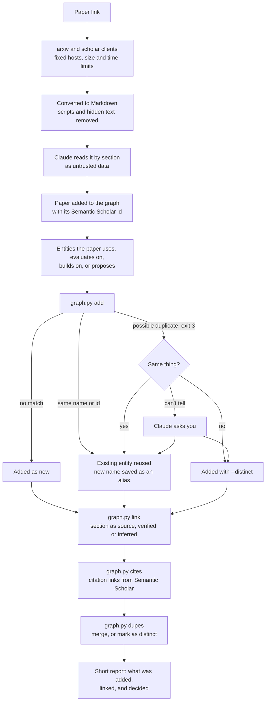

# paper-research

[](https://github.com/marfago-labs/paper-research/actions/workflows/ci.yml)
[](CONTRIBUTING.md)
[](https://www.python.org)
[](#why-its-different)
[](LICENSE)
[](https://docs.claude.com/en/docs/claude-code/plugins)

A Claude Code plugin for finding, reading, and discussing research papers with Claude, and keeping what matters: facts you pin, insights tied to their source papers, a knowledge graph of what papers use and build on, and a recap page you open in a browser.

Everything the plugin learns about you and your papers stays in plain files in your own workspace, where you can read, edit, and version it.

## Install

In a terminal:

```bash
claude plugin marketplace add marfago-labs/paper-research
claude plugin install paper-research@paper-research
```

Or start `claude` in a terminal and run `/plugin marketplace add marfago-labs/paper-research` and `/plugin install paper-research@paper-research`. The `/plugin` command isn't available in the VS Code chat panel, so use the terminal there. Afterwards, run `/reload-plugins` in the chat panel so it loads the plugin's skills.

Then open the folder you want to use for papers and run:

```text
/paper-research:init
```

`init` shows what it will create, then gives you one command to run, starting with `!`, which sets up the workspace. Check that its path points into the plugin's folder, then run it yourself because it changes Claude's own permissions and rules, and Claude Code's auto mode won't let Claude do that. Claude then follows the new rules straight away, and every new session loads them on its own. After updating the plugin, run `init --dry-run` to see what would change, then `init` to refresh the rules.

**Requirements:** Python 3.9 or later, standard library only. The `read` and `pin` skills use the Hugging Face MCP server when it's available, and skip it when it isn't.

## Use

Paste a paper link and Claude starts a discussion. Paste several, or say "for later", and Claude saves and triages them. The skills are also available by name:

| Skill | What it does |
|---|---|
| `add` | Saves links to `research/papers.md` and suggests whether to read, skim, or archive each one |
| `next` | Recommends what to read next, with each paper's publication date and academic standing |
| `read` | Analyses a paper, including its code and data, discusses it, and extracts it into the graph |
| `pin` | Saves a fact, such as a dataset, method, or finding, with its source |
| `insight` | Logs a takeaway and connects it to its source papers |
| `graph` | Queries and changes the knowledge graph, with duplicate checks on every change |
| `recap` | Refreshes the recap page in `research/recap/recap.html` |
| `scholar`, `arxiv` | Read-only clients for Semantic Scholar and arXiv, used by the other skills |
| `init` | Sets up or updates the workspace |

## How a paper gets into the graph

When you read or skim a paper, `read` fetches it through the plugin's own clients, then extracts it into the knowledge graph without waiting to be asked. If Claude reads a paper in plain chat instead, the recap page lists it under **Needs graph extraction**, and you can ask Claude to run `read` on it. Every change goes through `graph.py`, which checks for duplicates, validates the graph, and saves crash-safely.



See [Knowledge graph](docs/knowledge-graph.md) for the duplicate rules and what each relation means.

## Why it's different

### It reads papers through a retriever built to distrust them

A research assistant reads text written by strangers, in the same session that holds your notes. A paper can contain text written to look like instructions, and no software removes that risk completely. Instead of handing Claude a fetched web page, this plugin puts a retriever between the paper and Claude, built around that threat.

Papers come in through small, purpose-built clients for arXiv and Semantic Scholar, written in Python's standard library with no dependencies to install or to compromise:

- **Fixed destinations.** Each client contacts only its own hosts: `arxiv.org`, `export.arxiv.org`, and `api.semanticscholar.org`. A redirect anywhere else is refused, so your Semantic Scholar API key can never be sent to another host.
- **Read-only, with limits.** The clients never write to a remote service. Each request has a size cap and a time limit, and requests are spaced as the services ask, even across several windows at once.
- **Checked input.** Paper and author IDs are validated before they become part of a URL or a file name, so a crafted ID can't write outside your workspace.
- **Cleaned text.** arXiv papers are converted to Markdown by the plugin's own converter, which drops scripts, styles, and page furniture. It also removes text hidden from human readers, such as `display:none`, near-white or tiny text, and strips invisible characters that can smuggle instructions. Each removal leaves a visible `[hidden text removed: N characters]` marker and Claude is told to warn you, because hidden text in a paper is itself a warning sign.
- **Labelled as data.** Everything the retriever returns is marked as untrusted. Claude's rules say to treat it as data, never to follow links found inside papers without asking, and never to send your notes anywhere.
- **Sections you can check.** Papers are read by section, and Claude cites the section, page, or figure behind each claim, so you can verify it against the paper.

Claude Code's permission system enforces the rest. The table shows what is enforced, what is only instructions, and where the gaps are. [Security](docs/security.md) has the full detail.

| Protection | Strength | Limits |
|---|---|---|
| Approval prompt before Claude fetches a page from arXiv, Semantic Scholar, Hugging Face, or GitHub, even in auto mode | Enforced | You see the address of every fetch from those sites. Other sites prompt too, unless you've allowed them |
| No deny rules, so other skills and agents in the workspace can use any tool, such as `curl` or `gh`. Claude Code asks before a shell command you haven't allowed | Enforced, by Claude Code's default | A command you've allowed everywhere, such as `curl`, runs without a prompt here too. In auto mode, only its rules against fetching links found inside papers and sending workspace content out stand in the way |
| Approval prompt before Claude's file-edit tools change `lessons.md`, `profile.md`, `CLAUDE.md`, or `.claude/` | Enforced | Stops injected text from quietly making itself permanent through those tools. A shell command can still write these files without a prompt, unless `init --sandbox` is on |
| Rules to treat outside text as data and to propose changes to `profile.md` or `lessons.md` before making them | Instructions only | Reduce the risk, don't remove it. Auto mode gets matching rules that apply in auto mode only |
| `init --sandbox`: sandboxed shell commands that reach only arXiv and the Semantic Scholar API, with no unsandboxed escape. GitHub and Hugging Face are blocked outright, because a shell command there could publish your notes using your own login | Strongest | Off by default. Not supported on native Windows, where `init --sandbox` has no effect: use WSL2, macOS, or Linux. It can stop some shell commands from working |

Updates can't quietly widen your permissions. `init` adds no allow rules, and its only ask rules are approval prompts for editing a file and for fetching from a named host. If the settings template in an update contains any allow rule, or any other ask rule, `init` stops and changes nothing. It never removes a rule. With `--sandbox`, `init` also adds the sandbox's network hosts from the update, so run `init --dry-run` and read the diff before accepting an update.

### It gets better at finding what you care about

The plugin keeps a record of you as a reader, in plain files you can read and edit, and uses it every time it searches, triages, or recommends:

- **It listens.** Your questions and stated preferences go into a running log in `research/user-facts.md`, each marked as something you said, something you did, or something Claude inferred. Claude proposes changes to your reader profile in one line and you approve them, so it never decides who you are on its own.
- **Your ratings steer recommendations.** After a paper, you give it 1 to 5. Papers you rate 4 or 5 become examples of what to find more of, and papers you rate 1 or 2 become examples of what to avoid, in Semantic Scholar's recommendations.
- **Searches start from your interests.** `next` builds its arXiv searches from the topics in your profile and the questions you keep asking, then picks papers by fit with you first. It also checks each pick's standing in the research community, with the evidence, so a good match isn't taken for a good paper.
- **Triage knows your priorities.** When you save a stack of links, `add` suggests whether each is worth a deep read, a skim, or an archive, based on your profile.
- **It learns how you work.** When you correct Claude or confirm that an approach worked, it proposes a lesson, and once you approve it, every later session follows it.
- **It won't shrink your horizons.** About one recommendation in five is deliberately outside your usual topics, and labelled that way.

There is no hidden model. The personalization is in files you control, and it is Claude's judgement applied to them. See [Your workspace](docs/workspace.md) for the files and [Skills](docs/skills.md#next) for how `next` works.

## Your workspace

After `init`:

| Path | Holds |
|---|---|
| `CLAUDE.md` | A block of the plugin's rules, refreshed by `init`. Add your own notes outside the block |
| `research/` | Your facts, profile, papers, pins, insights, lessons, and graph |
| `.claude/settings.json` | The approval prompts and auto-mode rules that `init` adds |
| `.claude/settings.local.json` | Your own settings, such as denying MCP servers you don't want here. `init` never touches it |

## Documentation

| Read | To |
|---|---|
| [Getting started](docs/getting-started.md) | Install the plugin, set up a workspace, and read your first paper |
| [Skills](docs/skills.md) | See what each skill does, step by step, and what it changes |
| [Your workspace](docs/workspace.md) | Understand every file, its format, and the recap page |
| [Knowledge graph](docs/knowledge-graph.md) | See how entities, links, and duplicate checks work |
| [Security](docs/security.md) | Know what protects you from a malicious paper, and what doesn't |
| [Command reference](docs/reference.md) | Run the scripts yourself, with every option and exit code |
| [Troubleshooting](docs/troubleshooting.md) | Fix a message you didn't expect |
| [Contributing](CONTRIBUTING.md) | Change the plugin, and run its tests |

## Develop

```bash
for t in skills/*/scripts/test_*.py evals/*/test_*.py; do python "$t"; done
```

The duplicate check is measured against a frozen set of labelled pairs, which [the analysis notebook](evals/dedup/analysis.ipynb) describes and replays.

CI runs linters and formatters (ruff, ESLint, Prettier), complexity limits (cyclomatic 6, cognitive 10), static analysis (mypy, bandit, actionlint), a secret scan of every commit (gitleaks), unit tests on Linux with Python 3.9, 3.12, and 3.13 and on Windows with 3.13, coverage at 100%, and behaviour scenarios in Gherkin on Linux and Windows. Mutation tests run weekly and on request, because they take too long for every push. [CONTRIBUTING.md](CONTRIBUTING.md) says how to run each check.

## Licence

MIT. See [LICENSE](LICENSE).
