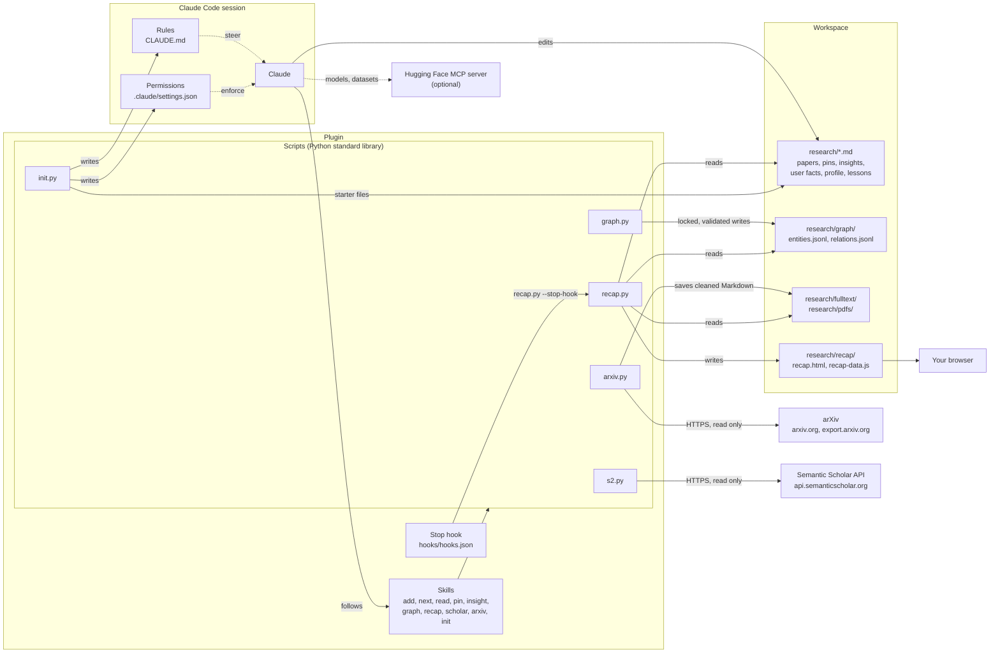

# Architecture

The plugin is a set of skills, five standard-library Python scripts, one hook, and a static page. It has no server and no database: everything it keeps is a plain file in your workspace.

## Components

| Component | What it does | What it writes |
|---|---|---|
| **Skills** (`skills/*/SKILL.md`) | Instructions Claude follows for each task: which script to run, what to check, and what to tell you. They hold the judgement; the scripts hold the rules a script can check. | Nothing themselves. Claude edits the Markdown files in `research/` as a skill says. |
| **`arxiv.py`** | Searches arXiv, reads a paper's metadata, saves its HTML version as Markdown, or downloads its PDF. Removes scripts, hidden text, and invisible characters. | `research/fulltext/`, `research/pdfs/`, and request-pacing state in `.cache/`. With `--out`, a JSON file in `research/` or a temporary folder. |
| **`s2.py`** | Queries Semantic Scholar: search, paper details, citations, references, batch lookups, and recommendations. Read only. | Request-pacing state in `.cache/`. With `--out`, a JSON file in `research/` or a temporary folder. |
| **`graph.py`** | The only way to change the knowledge graph. Checks duplicates, relation types, and sources, validates the whole graph, and saves under a lock, crash-safely. | `research/graph/entities.jsonl` and `relations.jsonl`. |
| **`recap.py`** | Builds the recap page's data from your research files and the graph. With `--stop-hook`, decides whether Claude should refresh the page before ending a turn. | `research/recap/`. Nothing with `--stop-hook`. |
| **`init.py`** | Sets up or updates a workspace. Refuses a settings template that would widen your permissions. | The plugin's block in `CLAUDE.md`, `.claude/settings.json`, the starter files in `research/`, and `.gitignore` entries. |
| **Stop hook** (`hooks/hooks.json`) | Runs `recap.py --stop-hook` when Claude is about to end a turn, and stops it once if the recap is out of date. | Nothing. |
| **Recap page** (`skills/recap/page/`) | A fixed page with all its rendering in `recap-lib.js`, and the graph drawn with a vendored copy of Cytoscape.js. It loads only files next to it, so it works offline. | Nothing. |

## Trust boundaries

- **Paper text is untrusted.** The plugin's scripts are the main way in: `arxiv.py` and `s2.py` contact fixed hosts, refuse redirects elsewhere, cap each response, and remove hidden text and invisible characters. Pages Claude fetches itself, PDFs, and other tools' results are not cleaned. Claude is told to treat all of it as data.
- **Your notes stay local.** No script sends your notes, only search queries and paper ids. The rules tell Claude not to send them either, and the optional sandbox limits shell commands to arXiv and Semantic Scholar.
- **The files that steer every session are protected.** Claude Code asks before its file tools edit `CLAUDE.md`, `.claude/`, `lessons.md`, or `profile.md`.

[Security](security.md) says which of these are enforced and which are only instructions.

## How a paper gets into the graph

See [Knowledge graph](knowledge-graph.md#how-papers-get-in) for the steps, with a diagram.

## Design decisions

- **Semantic Scholar (2026-11-05):** a read-only standard-library script with a fixed host and an optional API key from `SEMANTIC_SCHOLAR_API_KEY`, not an MCP server. Without a key, `search` is heavily rate-limited.
- **arXiv (2026-11-07):** a standard-library script, not an MCP server. It reads arXiv's HTML version as Markdown, and falls back to the PDF read by Claude Code's Read tool, so it needs no PDF converter.
- **Distribution (2026-11-07):** a Claude Code plugin. Plugins can't carry permission rules or `CLAUDE.md` content, so the `init` skill writes them into the workspace.
- **Stop hook (2026-11-15):** one `Stop` hook, because rules in `CLAUDE.md` to refresh the recap and log questions were dropped after long chains of skills. It only reads the research files, asks at most once a turn, and lets the turn end on any error.
- **Graph storage:** two JSONL files changed only through `graph.py`, which locks, checks for duplicates, validates, and saves crash-safely. Names and external ids are unique within a type, not across types.
- **Recap page:** a fixed page copied into the workspace, with all rendering in `recap-lib.js` so it can be tested in Node.
