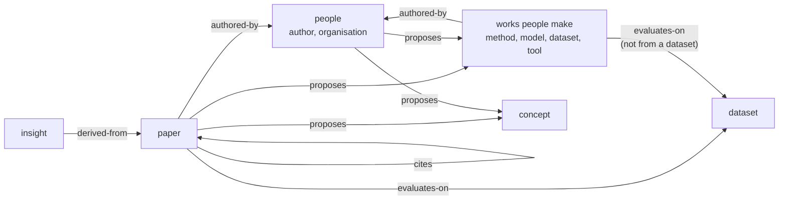

# Graph schema

The exact format of the knowledge graph, and every rule `graph.py` enforces on it. For how the graph is built and
used, see [Knowledge graph](knowledge-graph.md). A test checks the tables here against `graph.py`, so they stay exact.

## Files

The graph is two files in `research/graph/`, both UTF-8 with one JSON object per line. Blank lines are skipped, and
the order of lines carries no meaning.

- `entities.jsonl`: one entity per line.
- `relations.jsonl`: one relation per line.

Change them only through `graph.py`, which takes a lock, checks the whole graph, and saves both files crash-safely.
Every command refuses to load a graph that breaks a rule under [Rules every change keeps](#rules-every-change-keeps).

## Entities

### Entity types

| Type | What it is | Example id |
|---|---|---|
| `paper` | A paper or post. An arXiv paper's slug is its arXiv id. | `paper:2401.00007` |
| `author` | A person | `author:ann-lee` |
| `organisation` | A lab or company | `organisation:nvidia` |
| `concept` | An idea | `concept:semantic-state-space-model` |
| `method` | A technique | `method:retrieval-augmented-generation` |
| `model` | A trained model | `model:qwen-3-coder-next` |
| `dataset` | A dataset or benchmark. Each version is its own entity. | `dataset:terminal-bench-2-1` |
| `tool` | Software | `tool:mini-swe-agent` |
| `insight` | A takeaway logged in `research/insights.md` | `insight:review-agent-read-only` |

`author` and `organisation` are the **people** types. Every other type is a **work**.

### Entity fields

| Field | Type | Required | Meaning |
|---|---|---|---|
| `id` | text | yes | `type:slug`. Made from the name by `add`, or given with `--slug`. It only has to be unique: it never decides whether two entities are the same. |
| `type` | text | yes | One of the types above, and the prefix of `id`. |
| `name` | text | yes | The name the source uses, with its exact version, such as `Terminal-Bench 2.0`. |
| `aliases` | list of text | no | Other names for it, such as an acronym or its expansion. |
| `url` | text | no | A link that starts with `http://` or `https://`. |
| `note` | text | no | A short free-text note. |
| `ids` | object | no | External ids, by kind: see below. |
| `distinct_from` | list of text | no | Ids of entities of the same type that look alike but were judged different. |
| `no_authors` | text | no | Why a paper has no author to record, such as an anonymous submission. Dropped when the paper gets an author. |
| `standing` | object | no | A paper's citation data: see below. |

### External ids

`ids` maps a kind to non-empty text.

| Kind | Source |
|---|---|
| `s2` | Semantic Scholar |
| `arxiv` | arXiv |
| `doi` | DOI |
| `hf` | Hugging Face, as `org/name` |
| `github` | GitHub |
| `orcid` | ORCID |

An entity's external ids are its `ids`, plus two more sources: an alias written as `ARXIV:<id>` or
`DOI:<id>`, and, for a paper, a slug that is an arXiv id, such as `paper:2401.00007`. Ids are compared ignoring case
and surrounding spaces.

### Standing

Only a paper has a `standing`. It is copied from Semantic Scholar with the date it was checked, because counts change.

| Field | Type | Required | Meaning |
|---|---|---|---|
| `citations` | whole number | no | Citation count |
| `influential` | whole number | no | Influential citation count |
| `venue` | text | no | Where it was published |
| `year` | whole number | no | Year of publication |
| `checked` | date, `YYYY-MM-DD` | yes | When Semantic Scholar was asked. A paper it has no data for keeps only this. |

## Relations

### Relation fields

Every field is required.

| Field | Type | Meaning |
|---|---|---|
| `from` | text | The id of the entity the relation starts at. |
| `rel` | text | The relation type, below. |
| `to` | text | The id of the entity it ends at. |
| `source` | text | Where it comes from, such as `ARXIV:2401.00007, §2.2`. |
| `status` | text | How far it was checked, below. |

### Relation types

Read each relation as `from rel to`, such as `paper:2401.00007 evaluates-on dataset:terminal-bench-2-1`.

| Relation | From | To | Meaning |
|---|---|---|---|
| `authored-by` | paper, method, model, dataset, tool | author, organisation | Made by this person or lab. |
| `cites` | paper | paper | Cites the other paper. Added from Semantic Scholar's references. |
| `evaluates-on` | paper, method, model, tool | dataset | Reports results on this dataset or benchmark. |
| `proposes` | paper, author, organisation | concept, method, model, dataset, tool | Introduces it. |
| `uses` | a work | a work | Relies on it, such as a model run as a judge. |
| `builds-on` | a work | a work | Extends the other's idea or code. |
| `contradicts` | a work | a work | Reports a result or claim against the other's. Points from the work that disagrees. |
| `compared-with` | a work | a work | Is measured against it, such as a baseline. Points from the work that is measured, never the reverse. |
| `derived-from` | a work | a work | Comes from it, such as a new version of a benchmark, or an insight from a paper. |
| `related-to` | any type | any type | Connected in a way no other relation says. |

The relations other than `authored-by`, `cites`, and `derived-from` are the ones extracted by reading a paper. A
paper with none of them hasn't been extracted yet: `graph.py islands` lists it.

The table is exact. This shows its shape: the relations whose ends are narrowed.

Any two works can also be joined by `uses`, `builds-on`, `contradicts`, `compared-with`, or `derived-from`, and any
two entities by `related-to`.

### Status

| Status | Meaning | Source |
|---|---|---|
| `verified` | Checked in the source that made the claim. | Must name a document. |
| `reported` | Checked in a source that only quotes another study, such as a survey's table of other papers' scores. | Must name a document, and should name the study it quotes: `ARXIV:2401.00009, Table 2, quoting ARXIV:2401.00003`. |
| `inferred` | Claude's own reading, such as two papers from the same group. | The reason, in words. |

From weakest to strongest: `inferred`, `reported`, `verified`. When two copies of a relation meet, the stronger
status and its source are kept: `merge` keeps the stronger of two links it joins, and `link` upgrades an existing
link given a stronger status but never downgrades one.

A source **names a document** when it starts with one of:

- `ARXIV:` or `DOI:` and an id, such as `ARXIV:2401.00007, §2.2`;
- `paper:` and an id, a comma, and a place in that paper, such as `paper:2401.00004, §5.1`;
- a link, starting with `http://` or `https://`;
- `Semantic Scholar`.

Only the start counts: a reason that mentions an id, such as `same group as paper:2401.00004`, is an inference. The
rule can't tell whether the section says what the link claims. The recap page's Graph tab shows each source to check.

## Rules every change keeps

`graph.py` refuses to load or save a graph that breaks any of these.

- Every entity has a text `id` and `name`, and each field has the type in its table.
- Ids are unique, have a known type, and start with that type.
- Within a type, no two entities share a name or alias unless one lists the other in `distinct_from`. Names are
  compared in composed Unicode (NFC), so a decomposed `Jürgen` copied from a PDF is the same name, ignoring case
  and every space, dash, and connector such as `_`. Other punctuation counts: `GPT-4` is `gpt 4`, but `GPT.4` is
  not `GPT4`.
- Within a type, no two entities share an external id of the same kind, from any of its
  [sources](#external-ids): two papers can clash through an `ARXIV:` alias or an arXiv-id slug with no `ids` at all.
- `ids` uses only the kinds above. `distinct_from` names only other entities that exist. `url` is a web link.
- Only papers have a `standing`, and it follows its table.
- Every relation has all five fields, a known `rel` and `status`, a `source`, and existing entities at both ends,
  which are not the same entity.
- No relation is listed twice.

## Rules `validate` reports

A change can't break these, but an older graph might. `graph.py validate` lists each one and fails, while every
other command still loads the graph.

| Rule | How new changes keep it |
|---|---|
| A verified or reported relation's source names a document. | `link` and `add` refuse one that doesn't. |
| A relation joins the types its row allows. | `link` and `add` refuse other types, and say which types fit. |
| Every entity but a paper has at least one relation. | `add` saves it with its first link. `unlink` and `remove` warn about any entity they leave with none. |
| Every paper has an `authored-by` relation or a `no_authors` reason. | `add` and `read` save the authors, and `update --no-authors` records the reason. `validate` shows each reason so it can be checked. |

A paper may have no relations at all: it can wait in the reading list until it is read.
