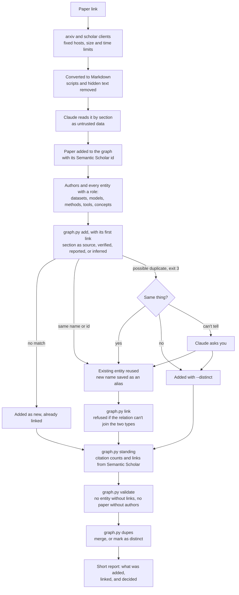

# Knowledge graph

The graph records what papers use, build on, and are evaluated on, and how those things connect to each other. It's how Claude can answer "which papers use Terminal-Bench?" or "how does this paper connect to that one?" from your own reading, with a source for every connection.

It lives in two files, `research/graph/entities.jsonl` and `research/graph/relations.jsonl`. Pins keep the facts, and the graph shows how things connect. The exact format, with every field, relation, and rule, is in [Graph schema](graph-schema.md).

## What's in it

**Entities** are the things papers talk about: papers, authors, organisations, concepts, methods, models, datasets, tools, and your logged insights. Each has an id such as `dataset:terminal-bench-2-1`, a name, other names it goes by, and, where known, stable ids from Semantic Scholar, arXiv, DOI, Hugging Face, GitHub, or ORCID. A paper also keeps its citation counts.

**Relations** connect two entities, such as a paper that `evaluates-on` a dataset or a method `compared-with` its baseline. Each relation joins only the types it makes sense for: a model can be `authored-by` the lab that made it, but a concept can't be `authored-by` anyone. A relation reads from its first entity to its second, so a method points `compared-with` its baseline, never the reverse, and each comparison is stored once.

Every relation records its **source** and its **status**, which says how far it was checked:

- `verified`: checked in the study that made the claim.
- `reported`: checked in a source that only quotes another study, such as a survey's table of other papers' scores.
- `inferred`: Claude's own reading, such as two papers from the same group.

## How papers get in

This is what happens when you read or skim a paper with `read`. Every change goes through `graph.py`, which checks for duplicates, validates the graph, and saves crash-safely.

- **`add` saves a paper and its authors** with their Semantic Scholar ids, and adds `authored-by` links and any citation links to papers you already have.
- **`read` extracts the rest, immediately,** without waiting for you to ask: every dataset, model, method, tool, and concept with a role in the paper, including the baselines it compares against and the models it runs or uses as judges, and the paper's authors if `add` didn't save them. It links each one to an existing entity when there is one, and adds a new entity, with its first link, when there isn't. So nothing but a paper is ever saved without a link to where it came from.
- **Citation links come from Semantic Scholar.** One batch request fetches the reference lists of many papers, and a `cites` link is added from each paper to every paper it cites that is also in your graph. A link joins two papers only if both are in the graph, so the links grow with it.
- **Each paper's citation counts are saved with it,** with the date they were checked. The `recap` skill checks again, in one batch request, any paper whose counts are more than 30 days old, which also picks up citation links to papers added since. A paper Semantic Scholar has no data for yet keeps only the date, and is tried again after 30 days.

A paper with only its authors and citations in the graph hasn't been extracted yet. The recap page lists those you have finished (status `done`) under **Needs graph extraction**, with any listed paper missing from the graph; a paper still waiting to be read is extracted when you read it. `graph.py islands` prints all of them. The page also lists any paper whose full text is saved in `research/fulltext/` but that `papers.md` doesn't list, because Claude read it without running `read`.

## Checking the links

A `verified` or `reported` link must name the document it was checked against, such as `ARXIV:2401.00007, §2.2`. `graph.py` refuses a reason in prose, such as "same research group", for either status, so such a link is `inferred`. A reported link also names the study it quotes, such as `ARXIV:2401.00009, Table 2, quoting ARXIV:2401.00003`.

When Claude later checks a reported or inferred claim in the study itself, it links it again as `verified`, and the link is upgraded: the new source replaces the old one. A link is never downgraded.

The rule can't tell whether the cited section really says what the link claims. The recap page's Graph tab shows each link's source and status, with reported and inferred links marked, so you can check.

`graph.py validate` lists what an older graph may still have wrong, without blocking any other command: a checked link that names no document, a link between types its relation can't join, an entity other than a paper with no links, and a paper with no authors. A paper with no author to record, such as an anonymous submission, says why with `graph.py update <paper> --no-authors "<reason>"`, and `validate` shows the reason so you can check it.

## Duplicates

The graph checks for duplicates itself, because by the time it has a few hundred entities, asking Claude to remember to search first isn't enough.

Adding an entity is refused or held back when it matches an existing one of the **same type**. The check is deliberately simple: it refuses only what needs no judgement, and holds anything that looks alike so that Claude can judge it.

| Situation | Result |
|---|---|
| Same external id | Refused, pointing to the existing entity |
| Same name, ignoring case and any space, dash, or underscore (`GPT-4` and `gpt 4`) | Refused |
| Same name, but both have an external id of the same kind with different values | Held back for a decision, exit code 3 |
| The new name is the other's alias, or the other way round | Held back |
| A similar name | Held back |

**Similar** means the two names share at least half of the shorter one's three-letter sequences, once accents, punctuation, and symbols are ignored. That one measure catches versions (`Terminal-Bench 2.0` and `2.1`), accents (`Jürgen` and `Jurgen`), initials (`J. Smith` and `John Smith`), reordered names (`Chang Ming-Wei`), and one name inside another (`MMLU` and `MMLU-Pro`). It also holds some names that are different, such as `C` and `C++`, which Claude then marks as distinct. If `add` holds too often or too rarely, the threshold is `SIMILARITY` in `graph.py`.

**Acronyms and other names** can't be recognised from spelling: nothing in `RAG` says `Retrieval-Augmented Generation`. So when Claude adds an entity, it passes the other names it knows with `--alias`, and the check finds the existing entity through them. Names are unreliable for people above all, which is why Claude also records Semantic Scholar ids for papers and authors whenever it has them.

Ids are made from the name and only have to be unique. If one is taken, `add` uses the next free one, such as `tool:c-2`, so an id never decides whether two things are the same. Pass `--slug` to choose an id yourself.

When something is held back, Claude decides each candidate on its own, or asks you if it can't tell:

- **It's the same thing:** it adds the new name as an alias of the existing entity.
- **It's different:** it adds the entity again, marked as distinct from that candidate. The decision is saved, so the pair isn't flagged again.

Each version of a benchmark, dataset, or model is an entity of its own (`LiveCodeBench v6`, not an alias of `LiveCodeBench`), because results measured on different versions can't be compared. Two entities of different types may share a name, such as a paper and the model it introduces. Two people with the same name can both exist, but only when marked distinct, and Claude then refers to them by id.

You can ask Claude to check the whole graph at any time (`graph.py dupes`) and to merge two entities that turn out to be the same (`merge`), which moves every connection across. To stay fast on a large graph, `dupes` skips three-letter sequences that more than 50 entities of the same type share, so it can miss a pair that `add` would hold. An empty `dupes` report isn't proof that there are no duplicates.

## Safe changes

All changes go through `graph.py`, which:

- **Takes a lock,** so two windows working on the same graph at once don't lose each other's changes. The lock is released by the operating system if a command crashes.
- **Validates the whole graph before saving,** and refuses the change if it would make it invalid.
- **Saves crash-safely.** Both files are written in full, marked complete, then swapped in. If a save is interrupted, the next command finishes it or discards it.

Don't edit the JSONL files by hand: a mistake there makes every command refuse to load the graph.

## Asking questions

Ask Claude in plain words. It uses these, and cites the source of each connection:

- **What's connected to X:** `neighbours`, with a depth.
- **How two things connect:** `path`, the shortest chain between them.
- **What's in the graph:** `stats`, `search`.

The recap page's Graph tab is the visual version: search, filter by type, and click an entity to see its connections and where each one comes from.

For every option of every command, see the [command reference](reference.md#graph).
